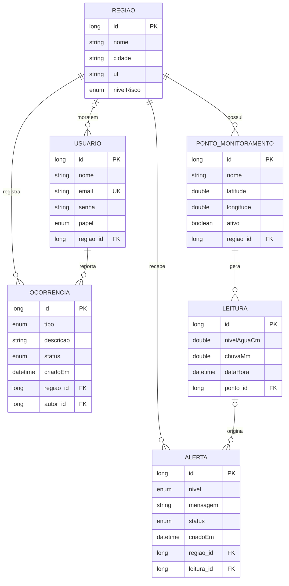

# AlertaBairro API

API REST em Java/Spring Boot da solução **AlertaBairro** (CitizenTech, Global Solution FIAP 2026/2): zeladoria colaborativa e alertas de risco de enchente para moradores de áreas vulneráveis. É consumida pelo app Flutter da disciplina de Mobile.

## Integrantes

| Nome | RM |  Turma  |
|---|---|---|
| Manuella Rinaldi | rm567915 | 2TDSPS |
| Gustavo Miguel Martins de Oliveira | rm566666 | 2TDSPB |
| Mariana de Paula Aguiar | rm566850 | 2TDSPB |

## Vídeos

- [Apresentação Java Advanced](https://youtu.be/MrB4x4IKO6A)
- [Pitch](https://youtu.be/5Lj6o5PiTPA)

## A solução

- **Cidadão beneficiado:** moradores de bairros que sofrem com alagamentos e falta de zeladoria e que hoje não sabem onde registrar o problema nem acompanhar a resposta.
- **Problema:** ocorrências urbanas não são reportadas, priorizadas nem acompanhadas, e a população recebe o alerta de risco tarde.
- **Como funciona:** sensores de nível de água enviam leituras; a API calcula o risco da região e gera alertas automáticos. Moradores reportam ocorrências (alagamento, buraco, iluminação) e acompanham o andamento; a Defesa Civil prioriza e resolve.
- **ODS:** 11 (cidades e comunidades sustentáveis), 13 (ação contra a mudança global do clima) e 10 (redução das desigualdades).

## Tecnologias

Java 21, Spring Boot 4.1, Spring Web, Spring Data JPA, Bean Validation, Spring Security com JWT (jjwt), Spring Cache (Caffeine), Spring HATEOAS, Actuator, Swagger/OpenAPI (springdoc), H2 (desenvolvimento) e PostgreSQL (produção), Lombok.

## Como rodar

**Pré-requisito:** JDK 21.

```bash
git clone [URL DO REPOSITÓRIO]
cd [PASTA DO REPOSITÓRIO]
./mvnw spring-boot:run        # Windows: mvnw.cmd spring-boot:run
```

A API sobe em `http://localhost:8080` com banco H2 em memória e **dados de exemplo** carregados automaticamente (3 regiões, 4 pontos, 9 leituras, 1 alerta, 3 ocorrências e 3 usuários). Os dados somem ao reiniciar.

- Swagger UI: `http://localhost:8080/swagger-ui.html`
- Ponto de entrada HATEOAS: `http://localhost:8080/api`
- Saúde: `http://localhost:8080/actuator/health`

**Variáveis de ambiente**

| Variável | Uso | Padrão |
|---|---|---|
| `JWT_SECRET` | Segredo de assinatura do JWT (mínimo 32 caracteres) | valor de desenvolvimento do `application.yml`; **defina em produção** |
| `SPRING_PROFILES_ACTIVE` | `prod` para usar PostgreSQL | `default` (H2) |
| `DB_URL`, `DB_USER`, `DB_PASSWORD` | Banco do perfil `prod` | sem padrão |

## Usuários de teste (dados de exemplo)

| Papel | E-mail | Senha |
|---|---|---|
| MORADOR | morador@alertabairro.com | Morador@123 |
| DEFESA_CIVIL | defesa@alertabairro.com | Defesa@123 |
| ADMIN | admin@alertabairro.com | Admin@123 |

São credenciais de demonstração, existentes só nos dados de exemplo.

**Testando no Swagger:** `POST /api/auth/login` → copie o `token` → botão **Authorize** → cole só o token. O token vale 1 hora. Ao trocar de usuário, faça Logout no Authorize antes de colar o novo token.

## Diagrama das entidades



## Modelagem: relacionamentos, cascade e fetch

- **Região → Ponto de monitoramento** (`@OneToMany`, `cascade = ALL`, `orphanRemoval = true`): o ponto não existe sem a região, então salvar ou remover a região propaga para os pontos.
- **Todos os `@ManyToOne` são `LAZY`**: o padrão do JPA é `EAGER`, que carrega relacionamentos que ninguém pediu e gera consultas em cascata (N+1). Só carregamos o relacionado quando necessário.
- **Leitura → Ponto**: mapeado só do lado da leitura, sem lista no ponto. Um ponto acumula milhares de leituras, e uma coleção mapeada seria perigosa; o histórico é consultado de forma paginada.
- **Alerta, Ocorrência e Usuário → Região**: sem cascade. Têm vida própria, e leituras e alertas formam histórico que não deve sumir com a exclusão de uma região. O banco recusa a exclusão e a API responde 409.
- **Enums com `EnumType.STRING`**: com `ORDINAL`, reordenar o enum corromperia os dados gravados.
- **Entidades nunca são expostas**: a API usa DTOs (`record`), o que evita erro de serialização de proxies `LAZY` e vazamento de campos internos (como o hash da senha).
- **Sem `@Data` nas entidades**: o `equals`/`hashCode`/`toString` gerado percorreria relacionamentos `LAZY` e poderia causar carregamentos indevidos ou recursão.

## Justificativa das consultas

- **Query method derivado** quando a condição é simples e o nome já a descreve (`findByNivelRisco`, `findByEmail`, `findByRegiaoIdAndStatus`, `existsByRegiaoIdAndNivelAndStatus`): é a opção mais legível e dispensa SQL manual.
- **`@Query` em JPQL** quando a consulta atravessa relacionamentos ou agrega: `findMaiorNivelAgua` navega Leitura → Ponto → Região e devolve o `max` usado na classificação de risco; `contarPorTipo` agrupa ocorrências por tipo com projeção direta em DTO; `findAtivosComRegiao` usa `join fetch` para trazer a região junto e evitar N+1 ao listar alertas.
- **`Specification`** em Ocorrência: o morador filtra por tipo, status, região e período em qualquer combinação. Um método derivado para cada combinação seria inviável; a Specification monta só os predicados que vieram preenchidos. O `@EntityGraph` no `findAll` carrega região e autor na mesma consulta.

## Regra de risco

O risco da região é o **pico de nível de água nas últimas 6 horas**, e não o valor da última leitura. Assim, uma leitura baixa isolada não cancela uma enchente em andamento. Limiares: BAIXO (< 50 cm), MEDIO (50 a 99), ALTO (100 a 149) e CRITICO (150 ou mais).

Alertas automáticos só são criados em risco ALTO ou CRITICO e nunca são duplicados enquanto houver um ativo no mesmo nível, evitando notificar a população repetidamente pelo mesmo evento. Leituras são imutáveis (sem PUT/DELETE) por serem histórico de sensor. Pontos inativos não aceitam leituras (422).

## Cache

Cache em memória com Caffeine (5 minutos, máximo de 500 entradas, estatísticas habilitadas).

| Cache | Consulta | Invalidado por |
|---|---|---|
| `regioes` | detalhe da região | atualizar/excluir região; registrar leitura |
| `riscoRegiao` | risco da região | registrar leitura; mudanças em alertas e na região |
| `alertasAtivos` | alertas ativos | criar/resolver/excluir alerta; registrar leitura |
| `estatisticasOcorrencias` | contagem por tipo | criar/editar/excluir ocorrência |

**Por quê:** são as consultas que o app repete com mais frequência e que só mudam quando há escrita. Listas paginadas não são cacheadas, porque cada combinação de página, ordenação e filtro gera uma chave diferente, com pouco reaproveitamento. A expiração de 5 minutos existe porque o risco usa uma janela deslizante de 6 horas: mesmo sem nenhuma escrita, o dado se renova.

Verificação: `GET /actuator/metrics/cache.gets?tag=cache:riscoRegiao&tag=result:hit` (requer ADMIN).

## HATEOAS

Os recursos principais devolvem `_links` para si (`self`) e para os relacionados (região → pontos, alertas, ocorrências, estatísticas e risco; ponto → leituras e última leitura). Os links de **ação** dependem do estado: `resolver` só existe em alertas ATIVOS; `avancar-status` e `editar` só existem em ocorrências ainda não resolvidas. O app decide o que exibir pela presença do link. As listas paginadas trazem `first`, `prev`, `next` e `last`, e `GET /api` é o ponto de entrada.

## Segurança

- Login em `POST /api/auth/login` devolve um JWT (HS256) com `id` e `papel`; as requisições enviam `Authorization: Bearer <token>`. A API é stateless.
- Senhas gravadas com BCrypt. O cadastro público cria sempre MORADOR.
- O autor de uma ocorrência é o usuário do token, nunca um campo do corpo.
- Respostas 401 e 403 seguem o mesmo formato de erro do restante da API.
- CORS liberado apenas para as origens de `app.cors.allowed-origins` (localhost e emulador Android `10.0.2.2`).
- Contrapartida do JWT: uma mudança de papel só vale quando o token expira.

| Ação | MORADOR | DEFESA_CIVIL | ADMIN |
|---|---|---|---|
| Consultar (GET) | sim | sim | sim |
| Reportar ocorrência | sim | sim | sim |
| Editar ocorrência, mudar status | não | sim | sim |
| Registrar leitura, criar/resolver alerta | não | sim | sim |
| Criar/editar/excluir regiões e pontos; excluir alertas e ocorrências | não | não | sim |
| Actuator (métricas) | não | não | sim |

## Tratamento de erros

Um `@RestControllerAdvice` converte exceções em um corpo padronizado (`timestamp`, `status`, `error`, `message`, `path`, `campos`). Mapeamentos: 400 (validação, JSON ilegível, parâmetro ou ordenação inválidos), 401 (sem token ou credenciais inválidas), 403 (sem permissão), 404 (recurso inexistente), 409 (duplicidade ou violação de integridade) e 422 (regra de negócio). O erro genérico é registrado em log, mas o cliente nunca recebe stack trace.

## Actuator

Expostos: `health` (público, sem detalhes), `info` e `metrics` (estes dois exigem ADMIN, exceto `info`, que é público).

## Uso de IA generativa

- **Ferramenta:** Claude (Anthropic).
- **Para quê:** apoio na estruturação do projeto por etapas, explicação de erros de execução e rascunho deste README.
## Estrutura do projeto

```
src/main/java/br/com/fiap/citizentech/
  assembler/       Montagem dos links HATEOAS
  config/          Segurança, cache, OpenAPI, paginação e carga de dados
  controller/      Endpoints REST
  dto/             Records de entrada e saída
  exception/       Exceções de domínio e handler global
  model/           Entidades JPA e enums
  repository/      Spring Data JPA
  security/        JWT: serviço, filtro e usuário autenticado
  service/         Regras de negócio
  specification/   Filtros dinâmicos
```